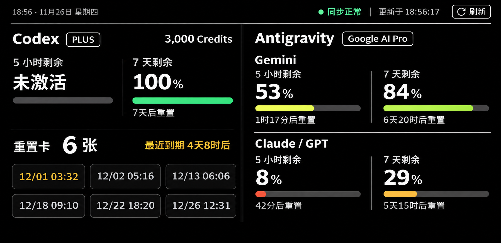
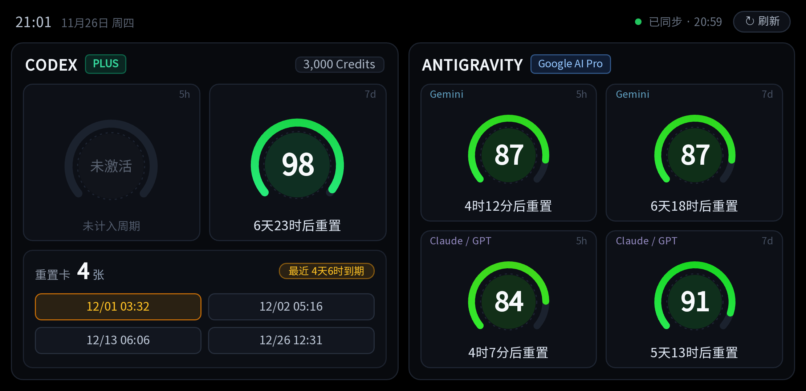
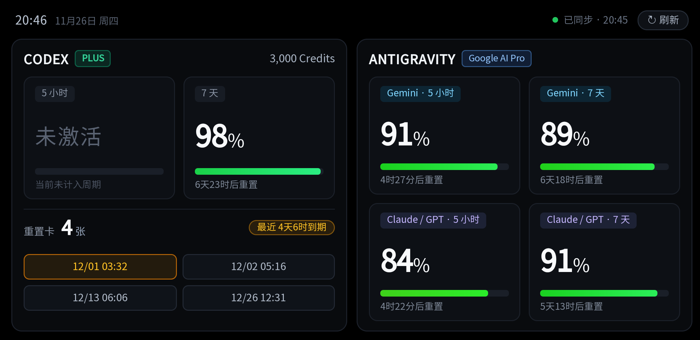

# AI Quota Display（Codex & Antigravity 桌面副屏监控）

> [!CAUTION]
> **Google 账号风控警示（2026-11-27）**
>
> Google 已明确提示：第三方工具直接调用其内部接口 `cloudcode-pa.googleapis.com`（如 `v1internal:retrieveUserQuotaSummary`、`fetchAvailableModels` 等）会导致 Google 账号被风控标记（flagged）。
>
> 当前版本中 `server.py` 通过 `codexbar --provider antigravity --source oauth` 定时查询 Antigravity 额度，经核实其底层调用的正是上述内部接口。**强烈建议暂停对 Antigravity 的第三方轮询，仅在 Antigravity 官方客户端内查看额度**；若仅需监控 Codex，可自行将 `server.py` 中的 `PROVIDERS` 修改为 `("codex",)` 后使用。

将一台闲置安卓手机（无需登录任何账号、无需 Root、支持 USB 或无线 ADB 连接）改造成桌面常亮小屏，实时显示当前 Mac 本机上的 **Codex**（5 小时 / 7 天剩余额度、Credits 余额、重置卡数量及到期时间）与 **Antigravity**（Gemini 与 Claude/GPT 的 5 小时 / 7 天剩余额度）订阅用量，并与 Mac 的锁屏/解锁/休眠自动联动息屏与亮屏。

> 本文档面向日常使用者及后续接手维护/二次开发的 AI Agent，所有路径、接口和约束均与当前代码实现严格一致。

---

## 一、整体架构

```text
┌─────────────────────────────────── macOS 主机 ───────────────────────────────────┐
│                                                                                  │
│  [CodexBar CLI]  ──(每 120s, --source oauth)──▶  [server.py]                     │
│  复用本机 OAuth                                  监听 127.0.0.1:8787              │
│  (无需开主程序)                                   提供 /, /api/quota, /api/refresh │
│                                                  持久化缓存 -> cache.json         │
│                                                           │                      │
│  [screen_sync.py]                                         │ adb reverse tcp:8787 │
│  监听 CoreGraphics 锁屏 / 休眠唤醒                         │                      │
│  维护无线 ADB 重连 & 端口转发                              ▼                      │
└───────────────────────────────────────────────────────────┼──────────────────────┘
                                                            │ USB / 无线 ADB
                                                            ▼
┌─────────────────────────────────── 安卓手机 ─────────────────────────────────────┐
│  浏览器（添加到主屏幕全屏 + ADB 沉浸模式）访问 http://127.0.0.1:8787              │
│  - 手机零账号登录、可断外网                                                        │
│  - Mac 锁屏/休眠 -> keyevent 223 自动息屏                                         │
│  - Mac 解锁/唤醒 -> keyevent 224 亮屏 + wm dismiss-keyguard 跳过锁屏 + 恢复转发    │
└──────────────────────────────────────────────────────────────────────────────────┘
```

---

## 二、目录结构与文件职责

| 文件 / 目录 | 职责说明 |
| :--- | :--- |
| `ctl.sh` | **主控脚本**（交互式菜单 + 子命令），统一管理启停、状态查看、日志查看以及 macOS `LaunchAgent` 开机自启动（含目录迁移防呆与残留进程清理）。 |
| `server.py` | 本地 HTTP 服务与后台定时采集器（纯 Python 3 标准库，仅监听 `127.0.0.1`），定时并行调用 `codexbar` 拉取数据、标准化字段并缓存到 `cache.json`。 |
| `index.html` | 当前生效的单文件前端仪表盘（默认使用 `主题/index2.html` 环形仪表盘主题，**严格兼容老版本 Android 浏览器内核**）。 |
| `主题/` | 内置 3 款横屏 AMOLED 主题（`index1.html`、`index2.html`、`index3.html`）、对应效果图及前端设计规范 `FRONTEND_SPEC.md`。 |
| `screen_sync.py` | macOS 锁屏/休眠联动守护进程（纯 Python 3 + `ctypes` 调用 `CoreGraphics`），负责手机自动息屏/亮屏、跳过滑动锁屏、防自动降亮度、维护 `adb reverse` 及无线 ADB 自愈。 |
| `config.env` | 独立配置文件（端口、轮询间隔、无线 ADB 地址），换电脑或换手机 IP 时只需修改此文件。 |
| `start.sh` / `stop.sh` | 快捷封装，内部直接转发调用 `ctl.sh start` / `ctl.sh stop`。 |
| `cache.json` | 运行时自动生成的最近一次采集快照，服务重启后可立即返回上次数据。 |
| `logs/` | 运行时自动生成，存放 `server.log`、`screen_sync.log` 及手动模式下的 `*.pid`。 |

---

## 三、前端主题预览与切换

项目在 `主题/` 目录内置了 3 款专为 18.5:9 横屏 Super AMOLED 优化的主题，当前默认生效的是 **主题 2（环形仪表盘）**。

### 主题 1：极简线条大字版（`主题/index1.html`）
纯黑底色配细分割线与醒目大字号，桌面远距读数最清晰。



### 主题 2：环形仪表盘版（`主题/index2.html`，当前默认）
圆弧仪表盘配深色圆角子卡片，视觉层次强、信息分区明确。



### 主题 3：深色卡片条形版（`主题/index3.html`）
圆角卡片配大号剩余百分比与底部进度条，风格均衡克制。



### 如何切换主题
直接将目标主题文件复制覆盖根目录的 `index.html` 即可。`server.py` 每次请求都会实时读取磁盘上的 `index.html`，**无需重启后台服务**，手机端刷新页面即可生效：

```bash
# 切换为主题 1（极简线条大字版）
cp 主题/index1.html index.html

# 切换为主题 2（环形仪表盘版 / 默认）
cp 主题/index2.html index.html

# 切换为主题 3（深色卡片条形版）
cp 主题/index3.html index.html
```

### 自定义新主题
如需自己设计或让其他大模型生成新主题，直接参考 [主题/FRONTEND_SPEC.md](主题/FRONTEND_SPEC.md) 中的视口尺寸、接口字段与老内核兼容红线，生成单个 `index.html` 覆盖即可。

---

## 四、环境要求与外部依赖

### 1. macOS 端依赖
- **Python 3**：系统或 Homebrew 的 Python 3（实测 `3.14.6`），**零第三方 `pip` 依赖**，完全使用标准库。
- **CodexBar CLI**（`steipete/CodexBar`）：用于复用本机 OAuth 态拉取 Codex 与 Antigravity 用量（实测 `0.53.0`）。
  ```bash
  brew install --cask codexbar
  ```
- **ADB**（`android-platform-tools`）：用于端口转发与手机屏幕控制。
  ```bash
  brew install --cask android-platform-tools
  ```
- **本机登录态**：在 Mac 上至少登录过一次 Codex 与 Antigravity（使本机存在有效的 OAuth 凭证）。日常监控期间**无需后台保持 Codex 或 Antigravity 主程序运行**。

### 2. 安卓手机端要求
- **无需 Root**（若已拆电池改直供电，无电池鼓包隐患；若带电池长期插电且已 Root，建议配合 Magisk `ACC` 模块限充 50%–60%）。
- 开启开发者选项中的 **USB 调试**（小米 / OPPO / vivo 等国产 ROM 需同时开启 **USB 调试（安全设置）** 以允许 `input keyevent`）。
- 建议将锁屏方式设为无密码（滑动锁屏即可，`wm dismiss-keyguard` 会自动跳过）。

---

## 五、配置说明（`config.env`）

首次部署可复制模板：`cp config.env.example config.env`。`ctl.sh` 启动时会自动加载同目录的 `config.env`（命令行显式传入的同名环境变量优先级更高）：

```ini
QUOTA_PORT=8787
POLL_INTERVAL=120
ADB_WIRELESS_TARGET=192.168.x.x:5555
```

- `QUOTA_PORT`：本地监听端口与 `adb reverse` 转发端口（默认 `8787`）。
- `POLL_INTERVAL`：向 `codexbar` 拉取线上数据的间隔秒数（默认 `120`，代码内置最低下限 `30`，不建议过低以防触发风控）。
- `ADB_WIRELESS_TARGET`：无线 ADB 自动重连目标地址；如果改为纯 USB 线连接，留空即可。
- 其他可选环境变量：`ADB_SERIAL`（多台设备时固定序列号）、`CODEXBAR_BIN` / `ADB_BIN`（自定义二进制路径，默认通过 `PATH` 自动探测）。

---

## 六、日常使用与手机端设置

### 1. 管理服务（交互式菜单）
```bash
./ctl.sh
```
菜单选项：
1. `1) 启动` / `2) 停止` / `3) 重启` / `4) 查看状态`
2. `5) 开启开机自启动` / `6) 关闭开机自启动`（写入/移除 `~/Library/LaunchAgents/com.local.ai-quota-display.*.plist`）
3. `7) 查看最近日志`

也支持非交互式子命令：
```bash
./ctl.sh start | stop | restart | status | enable | disable | logs
```

### 2. 手机端全屏与沉浸模式（首次配置一次即可）
1. 确保 `adb devices` 能看到设备，且服务已启动。
2. 在手机浏览器（Chrome 或三星浏览器）打开 `http://127.0.0.1:8787`。
3. 在浏览器菜单中选择 **添加到主屏幕**，以后从桌面快捷图标打开（无地址栏全屏），并横放手机。
4. 如需隐藏系统顶部状态栏与底部/侧边导航栏（防止 AMOLED 白色导航栏烧屏），可执行一次 ADB 沉浸式命令（以三星浏览器为例，Chrome 则替换为 `com.android.chrome`）：
   ```bash
   adb shell settings put global policy_control immersive.full=com.sec.android.app.sbrowser
   ```
   取消沉浸模式：`adb shell settings put global policy_control null`。

---

## 七、核心实现细节（二次开发 / AI Agent 必读）

### 1. `server.py` 接口契约
- `GET /`：实时读取磁盘上的 `index.html`（修改前端页面**无需重启服务**，手机刷新即生效）。
- `GET /manifest.webmanifest`：PWA 全屏横屏清单。
- `POST /api/refresh`：手动触发异步刷新（内置 15 秒防抖）。
- `GET /api/quota`：返回标准化后的 JSON：
  ```json
  {
    "fetchedAt": "ISO-8601 UTC",
    "refreshing": false,
    "pollIntervalSeconds": 120,
    "codex": {
      "ok": true,
      "plan": "plus",
      "source": "oauth",
      "creditsRemaining": 3000,
      "windows": [
        { "label": "5 小时", "usedPercent": null, "resetsAt": null, "inactive": true },
        { "label": "7 天", "usedPercent": 0, "resetsAt": "ISO-8601 UTC", "inactive": false }
      ],
      "resetCards": {
        "available": 4,
        "nextExpiresAt": "ISO-8601 UTC",
        "items": [{ "title": "完全重置", "expiresAt": "ISO-8601 UTC" }]
      }
    },
    "antigravity": {
      "ok": true,
      "plan": "Google AI Pro",
      "source": "oauth",
      "windows": [
        { "id": "antigravity-quota-summary-gemini-5h", "group": "Gemini", "label": "5 小时", "usedPercent": 17.1, "resetsAt": "..." },
        { "id": "antigravity-quota-summary-gemini-weekly", "group": "Gemini", "label": "7 天", "usedPercent": 5.0, "resetsAt": "..." },
        { "id": "antigravity-quota-summary-3p-5h", "group": "Claude / GPT", "label": "5 小时", "usedPercent": 0, "resetsAt": null },
        { "id": "antigravity-quota-summary-3p-weekly", "group": "Claude / GPT", "label": "7 天", "usedPercent": 0.8, "resetsAt": "..." }
      ]
    }
  }
  ```
- **容错机制**：单次拉取某一方失败时，若已有历史缓存，保留旧数据并附加 `staleError` 字段，防止页面变空；HTTP 服务启用 `allow_reuse_address = True`。

### 2. `index.html` 前端约束（重要）
- **老内核浏览器兼容红线**：目标设备为 Android 9（实测三星 Galaxy S8 `SM-G9500` 自带浏览器，内核版本较老）。**修改前端时严禁使用**：
  - ES2020+ 语法：可选链 `?.`、空值合并 `??`、无参数 `catch {}`（会直接导致整段 `<script>` 语法报错不执行）。
  - Flexbox `gap`（老内核不识别，必须用 `margin-right` / `margin-bottom`；Grid 布局需同时写 `grid-gap` 与 `gap`）。
  - 网络请求使用 `XMLHttpRequest`，避免老内核 `fetch` 兼容差异。
- **显示逻辑**：
  - 后端传 `usedPercent`，前端统一换算为 **剩余百分比** `100 - usedPercent` 并渲染对应宽度的进度条。
  - 预警色：`> 30%` 绿色、`≤ 30%` 琥珀黄、`≤ 10%` 红色。
  - Codex 重置卡 5 天内到期自动琥珀色高亮提醒。
  - 纯黑 `#000000` 背景 + 每 60 秒主容器在 `±3px` 内平滑位移，防止 OLED 烧屏。

### 3. `screen_sync.py` 联动与自愈机制
- **锁屏检测**：每 2 秒通过 `ctypes` 调用 `/System/Library/Frameworks/CoreGraphics.framework/CoreGraphics` 的 `CGSessionCopyCurrentDictionary()` 读取 `CGSSessionScreenIsLocked` 与 `kCGSSessionOnConsoleKey`（零子进程开销、无需编译 Swift/ObjC）。
- **休眠唤醒检测**：对比循环前后墙钟时间差，跳变超过 `5 × 轮询间隔` 即判定为从休眠唤醒。
- **防自动降亮度**：每次亮屏同步时设置 `svc power stayon true`、`settings put system screen_off_timeout 2147483647`、`settings put system dim_screen 0`，避免长时间不触控变暗。
- **无线 ADB 自愈**：设备离线时每 20 秒尝试 `adb connect <ADB_WIRELESS_TARGET>`；若出现 macOS 重启后常见的 `Operation not permitted` 或连接失败，自动执行 `adb kill-server` → `adb start-server` → `adb connect`（带 60 秒防抖）。

### 4. `ctl.sh` 搬家防呆设计
- 脚本内全路径动态基于 `DIR="$(cd "$(dirname "$0")" && pwd)"`，支持任意含中文路径。
- `LaunchAgent` 使用固定 Label（`com.local.ai-quota-display.server` / `com.local.ai-quota-display.screen-sync`），重复开启只会覆盖更新，不会产生重复启动项。
- 启动时若发现已开启自启但 `plist` 内路径与当前目录不一致，会自动重写并重载 `LaunchAgent`。
- 停止/启动前会自动兜底清理占用 `$QUOTA_PORT` 的旧 `server.py` 及残留 `screen_sync.py`。

---

## 八、迁移与新电脑部署指南

### 1. 本机更换目录
直接把整个文件夹移到任意位置，然后在新目录运行 `./ctl.sh` 选 **1（启动）** 或 **5（开启开机自启动）** 即可（即使移动前忘记停止或关闭自启，脚本也会自动清理旧进程并更新自启路径）。

### 2. 打包迁移到另一台 Mac
1. 打包整个项目目录（建议排除 `logs/` 和 `cache.json`，目录内不含任何账号密码或 Token）。
2. 在新 Mac 安装依赖并登录账号：
   ```bash
   brew install --cask codexbar
   brew install --cask android-platform-tools
   ```
   确认本机已登录 Codex 与 Antigravity，并可运行一次验证：
   ```bash
   codexbar usage --provider codex --source oauth --format json
   codexbar usage --provider antigravity --source oauth --format json
   ```
3. 按需编辑 `config.env`（修改 `ADB_WIRELESS_TARGET` 或留空改用 USB）。
4. 运行 `./ctl.sh` 启动或开启开机自启，手机端打开 `http://127.0.0.1:8787`。

### 3. 迁移到 Windows / Linux（如需二次开发）
- `server.py` 与 `index.html` 跨平台通用（Linux 下 `codexbar` 可用 `brew install steipete/tap/codexbar` 安装）。
- 唯一绑定 macOS 的部分是 `screen_sync.py` 中的 `is_mac_locked()`（`CoreGraphics`）和 `ctl.sh` 中的 `launchctl`；移植到其他系统时只需替换这两处实现。

---

## 九、常见故障排查

| 现象 | 原因与处理 |
| :--- | :--- |
| 手机重启电脑后无线 ADB 报 `Operation not permitted` | macOS 本地网络权限与旧 `adb` daemon 时序问题。`screen_sync.py` 会自动 `kill-server -> start-server -> connect`；也可手动执行这三条命令或改用 USB 直连。 |
| 手机打开页面只有框架、时钟显示 `--:--` | 浏览器内核不支持新 JS 语法。检查 `index.html` 是否误引入了 `?.`、`??` 等 ES2020 语法。 |
| 电脑解锁后手机亮屏但停在锁屏页 | 确认手机未设置密码/PIN（仅滑动锁屏），检查 `logs/screen_sync.log` 中 `wm dismiss-keyguard` 是否成功。 |
| 页面提示“连接电脑失败” | 检查 `adb reverse --list` 是否有 `tcp:8787`，以及 `./ctl.sh status` 中 `server.py` 是否运行中。 |
| 数据长时间不更新 | 查看 `logs/server.log` 或手动执行 `codexbar usage --provider codex --source oauth --format json` 检查本机 OAuth 登录态是否过期。 |
